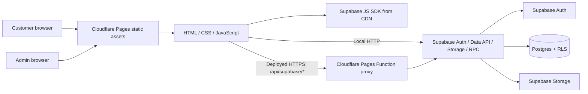
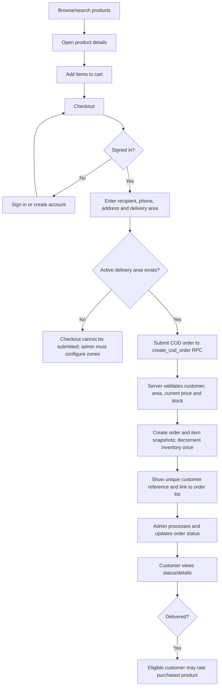
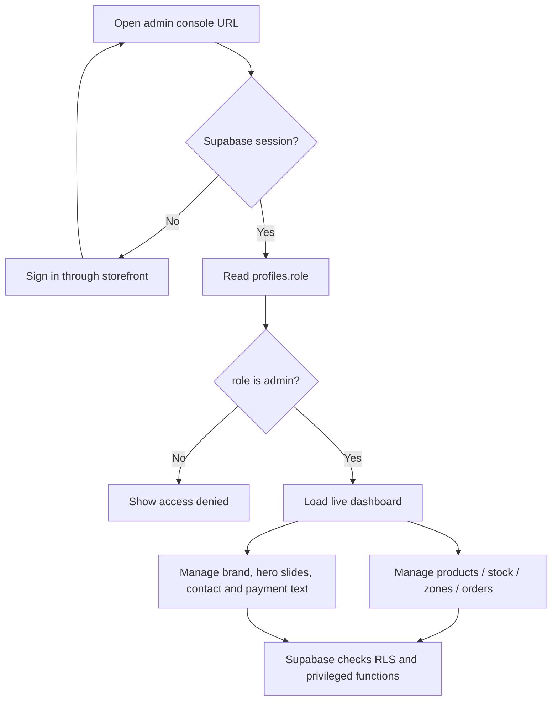

# Frostly — Project Documentation

**Project type:** Static bilingual frozen-food storefront with Supabase-backed commerce features  
**Frontend:** HTML, CSS, browser JavaScript  
**Hosting:** Cloudflare Pages  
**Database, auth, and file storage:** Supabase  
**Default language:** English; Bangla is available from the language selector

## 1. Project overview

Frostly is a responsive storefront for browsing frozen-food products, using a cart, placing Cash on Delivery (COD) orders, and viewing account/order information. The administrator console manages catalog data, stock, delivery zones, order statuses, and selected storefront settings.

The site is a static frontend, not a server-rendered framework application. Supabase provides the backend services. On Cloudflare Pages, browser Supabase HTTP requests are routed through a same-origin Pages Function reverse proxy. The Supabase JavaScript SDK itself and some imagery/fonts are loaded from external CDNs, so those resources need network access.

## 2. Repository map

| Path | Purpose |
| --- | --- |
| `index.html` | Storefront markup, overlays, product detail, account, cart, checkout, orders and assistant panels |
| `styles.css` | Storefront and responsive styling |
| `app.js` | Storefront behavior, language, cart, account, checkout, product details, ratings, settings and order UI |
| `console-a84d8903f59b4d358c8cc927633a11f6.html` | Administrator console document (obscure filename is only a convenience; authorization is enforced separately) |
| `admin-app.js` | Admin authorization, dashboard data, orders, products, inventory, delivery zones and settings |
| `supabase-config.js` | Public Supabase project URL and anon/publishable key. Never put a service-role key here. |
| `supabase-proxy.js` | Rewrites Supabase SDK HTTP requests to the same-origin proxy on deployed HTTPS pages |
| `functions/api/supabase/[[path]].js` | Cloudflare Pages Function that forwards allowed Supabase API traffic |
| `_routes.json` | Limits Pages Function invocation to `/api/supabase/*` |
| `supabase/migrations/` | Ordered SQL schema, policies, RPCs, storage and feature migrations |
| `README.md` | Short setup overview and migration/admin bootstrap instructions |

## 3. Architecture



The browser uses the public anon/publishable key. Row Level Security (RLS), database functions, and role checks must enforce permissions; the key and a hard-to-guess HTML filename do not grant or protect administrator access by themselves. The proxy forwards API calls; it is not an authentication layer and does not replace Supabase policies.

## 4. Main flows

### 4.1 Customer order flow



The displayed reference is formatted from the order UUID and date (`FST-YYYY-…`), while the database can retain an internal numeric order number. Do not use the display reference as an authorization credential. Order access is governed by user ownership and database policies.

### 4.2 Admin workflow



### 4.3 Review/rating flow

Only an authenticated customer whose order is marked `delivered` and whose order items include the product can create or update one review for that product. Ratings are 1–5 stars and review text is limited to 500 characters. Public users may read reviews. Run migration `202610220009_product_ratings.sql` to enable the feature.

## 5. Backend and data

Supabase is the system of record for accounts, products, orders, delivery zones, storefront settings, and reviews. Exact columns and constraints are defined in the SQL migrations; consult those files before changing schema or policies.

### Migrations (apply in order)

1. `202610200001_frostly_core.sql` — core profiles/catalog/customer data/orders/inventory/status history, RLS and database functions.
2. `202610200002_chattogram_delivery_zones.sql` — active Inside Chattogram Town (৳80) and Outside Chattogram Town (৳120) delivery zones.
3. `202610200003_admin_inventory_adjustment.sql` — secure admin stock adjustments and movement history.
4. `202610200004_customer_profile_settings.sql` — profile phone/avatar fields and avatar storage permissions.
5. `202610200005_default_delivery_address.sql` — default saved-address support.
6. `202610200006_admin_product_image_uploads.sql` — product image bucket and admin-only upload policies.
7. `202610200007_storefront_settings_slider.sql` — editable brand/logo and homepage slides.
8. `202610200008_site_contact_settings.sql` — editable service area, phone, email and payment display settings.
9. `202610220009_product_ratings.sql` — verified delivered-order product ratings and reviews.
10. `202610220010_staff_roles_and_user_management.sql` — staff roles, RLS/RPC authorization, superadmin-only account role management and manager permissions.

Use the Supabase SQL Editor to run each migration in order for a new project. Existing projects should apply only migrations not already applied. Do not paste Markdown formatting or backticks into the SQL Editor. Review SQL and back up production data before schema changes.

Staff roles are `superadmin`, `admin`, `ordermanager`, `stockmanager`, `catalogmanager`, `deliverymanager`, and `settingsmanager`, alongside customer and delivery roles. The migration promotes the earliest existing administrator to superadmin if no superadmin exists. Superadmins assign roles to existing accounts through security-definer RPCs; role changes are audited, direct profile role edits are blocked, and the last superadmin cannot be removed. If a new installation has no existing admin, bootstrap its first superadmin from the trusted SQL Editor using the profile-role trigger procedure in `README.md`.

### COD checkout integrity

The `create_cod_order` database function is the authoritative checkout operation. It validates the authenticated customer, products and quantities, reads current catalog prices and stock, checks the active delivery zone and fee, stores item snapshots, calculates the total, changes inventory, and uses a request ID for retry idempotency. The client-side total is an estimate only. COD is the configured payment method; no online payment gateway is implemented.

## 6. Security model and operational cautions

- Keep only the Supabase project URL and public anon/publishable key in browser files. Never publish `service_role`, database passwords, or other secrets.
- Create a normal account first, then grant the first admin role from the trusted Supabase SQL Editor as documented in `README.md`. There is no public admin-signup flow.
- Admin page filename obfuscation is not security. The page checks the logged-in profile role; RLS/database functions must continue to enforce permissions even if someone opens the URL directly.
- Staff permissions are role-based: order managers access order/customer operations, stock managers access stock operations, catalog managers edit products, delivery managers manage delivery zones, settings managers edit storefront settings, admins run normal operations, and superadmins also manage staff roles. Hiding a page in the browser is a usability measure; SQL policies and RPCs enforce permissions.
- Do not disable RLS or grant broad write access to solve a storefront issue. Inspect policy/function errors and use least privilege.
- Public product media and selected storefront settings are intentionally readable. Admin writes/uploads are restricted by policies.
- Verify email confirmation, Site URL, and redirect URLs in Supabase Auth for local and production origins. Password recovery depends on a valid redirect configuration.
- Replace demo products, image URLs, contact details, and any demo copy before operating a real shop. Do not represent demo reviews or stock as verified.
- The customer assistant is catalog-grounded demo behavior, not an OpenAI-backed assistant. Newsletter signup persistence is not wired. No payment gateway, delivery-staff workflow, or full business policy system is implemented.
- Supabase should be treated as a single configured project/database here. No database sharding or read-replica routing is currently implemented.

## 7. Local development

From the repository root:

```powershell
py -m http.server 8000
```

Open `http://localhost:8000`. Leave the terminal running while using the site; press `Ctrl+C` to stop the server. Local HTTP uses direct Supabase API calls, so verify the project URL/key and Auth redirect settings. If backend configuration/migrations are absent, the static demo portions may render but live authentication, checkout and admin data will not work.

## 8. Cloudflare Pages deployment

The repository is plain static HTML/JS with a Pages Function. For a Git-connected Pages project:

- Framework preset: **None**
- Build command: leave blank
- Build output directory: `/` (repository root)
- Root directory: repository root, unless the project is intentionally nested
- Ensure `functions/api/supabase/[[path]].js`, `supabase-proxy.js`, and `_routes.json` are committed.
- If the Supabase project URL changes, set Pages variable `FROSTLY_SUPABASE_URL` to the project URL. The proxy otherwise uses its configured project default.
- Push changes to the configured production branch and wait for the Pages deployment to report success. Confirm the deployed commit matches the intended commit; then hard-refresh or use a private window if stale browser assets persist.

No build step transforms these files. A successful upload does not prove that database migrations, Auth settings, or RLS are correct. Inspect browser console/network responses and Supabase logs when backend calls fail.

## 9. Configuration checklist for a new environment

1. Create a Supabase project and set `url` and public anon/publishable key in `supabase-config.js`.
2. Apply migrations 1–9 in sequence.
3. Configure Supabase Auth email confirmation, Site URL, and allowed redirect URLs for localhost and the live site.
4. Create an account through the storefront; promote the trusted initial admin using the SQL in `README.md`.
5. Sign in and check that the admin console passes role validation.
6. Replace demo catalog values; verify product prices, inventory, images, delivery areas/fees, contact values and site branding.
7. Place a low-value COD test order, verify order ownership and unique display reference, update its status in admin, and validate delivered-order rating eligibility before public launch.
9. Configure Cloudflare Pages root/output settings and deploy the production branch.

## 10. Troubleshooting

| Symptom | Checks |
| --- | --- |
| `localhost` times out | Keep `py -m http.server 8000` running in the correct repo directory; open `http://localhost:8000`, not HTTPS. |
| Storefront loads but live data does not | Check `supabase-config.js`, browser console/network requests, Supabase project availability, and whether required migrations were applied. |
| Checkout says no delivery areas | Apply migration 2 and confirm active rows exist in `delivery_zones`. |
| Admin page is blank/denied | Sign in first; confirm the signed-in user's `profiles.role` is `admin`; ensure migrations and RLS policies are present. The obscure filename does not bypass the role check. |
| Product/settings image upload fails | Apply the corresponding storage migration; use JPG, PNG, or WebP within the configured 5 MB limit; confirm the account is admin. |
| Footer contact fields are absent/stale | Apply migration 8; save values in Admin → Settings; confirm the deployed browser loads the current `app.js`; inspect the `site_settings` row with id `main` and the read policy. |
| Password reset returns to the wrong page | Check Supabase Auth Site URL and redirect allow-list for the deployed domain. |
| Pages deployment has no build output | This is expected for the static site: no build command, root output directory `/`. Confirm the repository root is selected. |

## 11. Change management

Keep SQL changes as ordered migration files. Update this guide and `README.md` when configuration or behavior changes. Avoid hand-editing production data through broad SQL updates; use the admin UI or narrow reviewed SQL. Commit source and migrations together so Cloudflare Pages and Supabase schema changes can be tracked independently.
