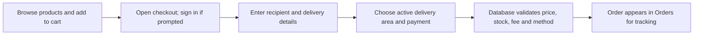
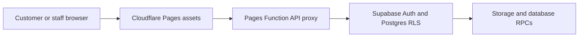
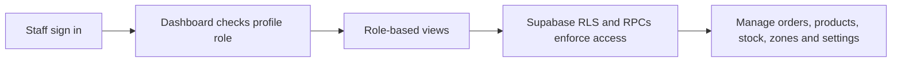

# Frostly Complete User Manual and Workflows

Prepared 22 October 2026

This guide explains how customers use Frostly, how staff manage the store, and how the website is configured and deployed. It describes the current implementation: a bilingual storefront backed by Supabase and hosted on Cloudflare Pages. The included flowcharts show the order and administration paths from start to finish.

## Contents
- 1. Frostly at a glance
- 2. Customer guide
- 3. Checkout and mobile wallet payments
- 4. Orders, delivery, and ratings
- 5. Admin dashboard guide
- 6. Staff roles
- 7. Setup and deployment
- 8. Security and operational notes
- 9. Troubleshooting
- Appendix A. Supabase migrations
- Appendix B. First superadmin bootstrap

# 1. Frostly at a glance

Frostly is a responsive English and Bangla frozen-food storefront. English is the default language. Customers can browse products, manage a cart and profile, place orders, follow order status, and rate eligible delivered purchases. Staff use a role-protected dashboard to manage the catalog, stock, delivery areas, orders, payment instructions, and selected storefront content.

| Area | Managed from | Notes |
| --- | --- | --- |
| Products, prices, stock, and categories | Admin dashboard and Supabase | Store data is database-backed; replace demo items before real sales. |
| Brand name, logo, homepage slides and copy | Admin dashboard settings | Bilingual copy fields are available where supported. |
| Contact details and payment options | Admin dashboard settings | Footer contact and checkout choices are editable. |
| Delivery area names and fees | Admin dashboard delivery section | Only active areas appear during checkout. |
| Accounts, orders, roles and reviews | Supabase with dashboard views | RLS and server-side functions enforce permissions. |
| Page layout, styling and behaviors | Project source code | The dashboard does not rebuild the site layout. |

> “Dynamic” means supported store data and settings are loaded from Supabase. Visual layout and frontend behavior still come from the deployed HTML, CSS, JavaScript, and Cloudflare Function.

# 2. Customer guide

## Open the store and choose a language

1. Open the live storefront at https://frostly-400.pages.dev/ or use the local server instructions in section 7.
2. The store starts in English. Choose বাংলা from either language menu to switch the page; the selection is remembered in that browser.
3. Use the home page, categories, best sellers, search, or product list to find an item.
4. Open a product to see its larger image and details. Choose Add to Cart, then open the cart icon to review quantities and subtotal.

## Create an account or sign in

1. Choose the profile icon, then Create an account. Enter your name, email, and password.
2. If Supabase email confirmation is enabled, open the confirmation email before signing in.
3. Returning customers choose Sign in. Use Forgot password if you need a reset email.
4. Checkout requires an authenticated customer account. If checkout redirects to sign in, sign in and checkout will continue.

## Edit a customer profile

- Open the profile icon while signed in to view the account panel.
- Edit profile lets you change the display name, phone number, and profile photo. Supported profile photo formats are JPG, PNG, and WebP, up to 3 MB.
- Change password asks for the current password and a new password entered twice.
- Change email asks for the new email and current password. The sign-in email changes only after the Supabase verification link is confirmed.
- Manage saved addresses and mark a default address where those controls are available. Sign out on shared devices.

# 3. Checkout and mobile wallet payments



## Place an order

1. Open the cart and choose Checkout. If asked, sign in or create an account; the checkout flow resumes after successful sign-in.
2. Check the recipient name, Bangladesh phone number, full address, and delivery area. Add optional instructions or notes as needed.
3. Choose a delivery area. The estimate updates with its configured delivery fee. An area must be active in the admin dashboard to appear.
4. Review the cart, estimated subtotal, delivery fee, and total. The database recalculates current prices, stock, and fee when the order is submitted.
5. Select Cash on Delivery or an enabled mobile wallet and place the order.

## Cash on Delivery

For COD, place the order in checkout and pay the delivery person when the order arrives. COD can be enabled or disabled from the admin payment settings. The database checks the enabled setting when accepting a new order.

## bKash, Nagad, and Rocket manual payment

1. In checkout, select the enabled wallet shown in the payment method menu.
2. Send the exact checkout total using the wallet’s Send Money service to the receiving number shown on screen.
3. Enter the transaction ID from the wallet confirmation, then place the order.
4. The order is recorded as awaiting payment verification. An order manager or administrator checks the transfer and marks payment verified in the dashboard.

> Default receiving number: 01811111111 for bKash, Nagad, and Rocket until changed in Admin > Settings > Checkout payment options. This is a manual transfer workflow, not a connected payment gateway. The website does not initiate a wallet transfer or verify money automatically. Do not hand over goods until staff verify the payment.

## If checkout is unavailable

- Sign in first; checkout is account-based.
- Make sure the cart still contains active, in-stock products.
- Confirm that at least one delivery area is active and has an actual fee.
- Confirm that a payment method is enabled and, for a wallet, that a valid receiving number is configured.
- If a wallet submission fails because the SQL function is missing, apply migration 202610220014_manual_mobile_payments.sql in Supabase SQL Editor.

# 4. Orders, delivery, and ratings

- Use the separate Orders icon beside the cart to open your order list. Refresh the list or filter all, in-progress, delivered, and cancelled orders.
- Select an order reference to expand purchased products, delivery details, totals, payment method, and transaction reference where present.
- Order IDs displayed to customers use a date plus a UUID-based reference such as FST-2026-…; the internal numeric sequence is not the security credential.
- After an order is marked Delivered, a customer can rate a purchased product from 1 to 5 stars and optionally leave a short review. Only eligible verified purchases can be reviewed.

| Order status | Meaning |
| --- | --- |
| Pending confirmation | Order received and waiting for staff confirmation. |
| Confirmed / Preparing / Packed | Staff accepted and are preparing the order. |
| Out for delivery | Order is on the way to the customer. |
| Delivered | Order is complete; eligible products can be rated. |
| Cancelled | Order was cancelled by authorized staff. |

# 5. Admin dashboard guide

## Sign in and open the dashboard

Sign in to the storefront with an account assigned a staff role, then open the admin console link or its console page. The console checks the Supabase profile role. A guessed or shared URL alone does not grant administrator access. If access is denied, verify that the signed-in account has the intended role in public.profiles.

## Overview

- Review order totals, awaiting-confirmation counts, gross sales, and low-stock products.
- Select the low-stock metric to open inventory and adjust stock or reorder details.
- Refresh the dashboard after changes from another staff member.

## Orders

1. Open Orders and use the processing/delivered shortcuts, status filters, or search to find a record.
2. Check the full customer-facing order reference, customer contact, delivery address, products, total, and payment details.
3. Choose a permitted order status and save it. Status history is recorded by the database.
4. For wallet orders, inspect the customer’s transaction ID and verify the transfer in the wallet account independently. Only then choose Mark payment verified.

## Products and inventory

1. Open Products to create or edit a product or bilingual category.
2. Set its category, English and Bangla names, description, price, package size, active state, and stock.
3. Upload a JPG, PNG, or WebP product image (up to 5 MB) when the image option is available.
4. Save changes and confirm the item is active. Use Inventory for stock adjustments and audit history.

## Delivery areas

Open Delivery to add or edit a delivery area, set the actual fee, and choose whether it is active. The initial Chattogram configuration is Inside Chattogram Town at BDT 80 and Outside Chattogram Town at BDT 120. Verify fees before enabling zones; checkout and the order RPC only accept active areas.

## Settings: brand, homepage, contact, and payment

- Site identity: change the site name and upload the logo.
- Homepage: add, edit, or remove hero slides and edit bilingual headline/copy fields. Save settings to publish them.
- Contact: set the service area, phone, email, and footer payment display text.
- Checkout payment options: enable/disable COD, bKash, Nagad, and Rocket; edit each wallet receiving number; save payment options.
- Phone numbers are validated before saving and again by the order database function. The active payment-method list is read from Supabase.

## Superadmin user management

1. Open User Management to switch between customer accounts and staff accounts, and search by name, email, user ID, or role.
2. Change the role for an existing account and save. New staff must first register and confirm an account.
3. Use customer/staff deletion controls carefully. Database functions block protected accounts and linked records where deletion is unsafe.
4. At least one superadmin must remain. The active superadmin cannot remove their own superadmin access.

## Admin profile and email

Open the administrator name/avatar menu to view the signed-in identity and sign out. Change the account email through the profile/email option using password reauthentication and Supabase email verification. Configure Supabase Auth Site URL and redirect allow-list for the live Frostly domain.

| Role | Dashboard access |
| --- | --- |
| Superadmin | All dashboard areas; user/staff management and role assignment. |
| Administrator | Overview, orders, products, inventory, delivery, customers, and settings. |
| Order manager | Overview, orders, and customer/order operations. |
| Stock manager | Overview and inventory operations. |
| Catalog manager | Product and category editing. |
| Delivery manager | Delivery areas and fees. |
| Settings manager | Brand, homepage slides/copy, contact, and payment settings. |
| Delivery staff | Role exists; full assignment workflow is limited/not configured in the dashboard. |

# 6. Main system flows



## Customer order and payment path

The customer browser reads the catalog and settings from Supabase. Checkout submits an idempotency request ID and cart item IDs to a database function. The function checks the authenticated user, active zone, payment method, current database prices, stock, and transaction-reference format; it writes the order and item snapshots and adjusts stock in a single transaction. Wallet payments are stored as pending verification until staff independently verify them.

## Admin access path

The console reads the signed-in session and profile role. It shows role-permitted views, while Supabase RLS and security-definer functions enforce sensitive reads and writes independently. Hiding a navigation item is not the security boundary.



# 7. Setup and deployment

## Run the site locally

```text
py -m http.server 8000
# Open http://localhost:8000
# Stop the server with Ctrl+C
```

Run the command from the Frostly project folder. Keep the terminal open while using the local site. Local HTTP calls Supabase directly; the deployed site routes Supabase HTTP requests through the same-origin Cloudflare Pages Function.

## Connect Supabase

1. Create/open the Supabase project. Put its Project URL and public anon/publishable key in supabase-config.js. Never put a service-role key or database password in frontend files or Cloudflare public variables.
2. Run the ordered migrations in Appendix A through Supabase SQL Editor. Existing projects should apply only migrations they have not already applied.
3. Configure Supabase Auth email confirmation, Site URL, and allowed redirect URLs for localhost and the live Pages domain.
4. Register the trusted owner account in Frostly and promote it to superadmin using the controlled bootstrap procedure in Appendix B if no superadmin exists.
5. Replace demo products, images, sample contact details, prices, and stock. Verify the two delivery fees and configure wallet numbers before inviting customers.

## Cloudflare Pages build settings

| Setting | Value |
| --- | --- |
| Framework preset | None |
| Build command | Leave blank (plain static files and Pages Function). |
| Build output directory | / (repository root). |
| Root directory | Repository root. |
| Deployment source | GitHub repository; push to the production branch and wait for deployment success. |

Keep functions/api/supabase/[[path]].js, supabase-proxy.js, and _routes.json in the repository. Set FROSTLY_SUPABASE_URL in Pages variables only if the Supabase project URL changes. A successful Pages deployment does not run Supabase migrations; schema changes must be applied separately in Supabase.

## Update the live site

1. Edit source in the project repository and commit the changed files.
2. Push the production branch to GitHub.
3. Wait for Cloudflare Pages to report a successful deployment and verify the deployed commit.
4. Apply any new SQL migration in the correct Supabase project. Do not assume a Git push applies SQL.
5. Hard-refresh the live page or open a private window if old JavaScript is cached.

# 8. Security and operational notes

- Only the public Supabase URL and anon/publishable key belong in browser code. Never expose service-role keys, database credentials, Auth tokens, or wallet account credentials.
- The Cloudflare Pages Function is a reverse proxy, not a login system. Supabase Auth, RLS policies, profile roles, and server-side functions enforce access.
- The admin console filename is not a security feature; normal customer accounts should fail the role check.
- Order references are identifiers for support, not passwords or access tokens. Customer order reads are limited by ownership policies.
- Manual wallet payment only records a submitted transaction ID. Staff must verify money received before marking it verified or fulfilling the order.
- The assistant is a local/catalog-grounded demo and is not a production AI service. The page design is code-managed. Delivery-staff assignment workflow is limited.
- Back up production data before schema changes. Do not disable RLS or grant broad writes to make a dashboard feature work.

# 9. Troubleshooting

| Issue | Check or action |
| --- | --- |
| Profile icon does nothing | Refresh after the latest Cloudflare deployment; confirm app.js is the current version and no JavaScript error appears in the console. |
| Checkout sends me to profile/sign-in | Sign in; checkout resumes after successful sign-in. Close any other drawer if it remains open. |
| Checkout fields reset while typing | Hard-refresh after the checkout-render fix deploys; this behavior was caused by repeated settings reloads. |
| No delivery areas appear | Admin > Delivery: activate an area and set a real fee. Confirm delivery_zones contains active rows. |
| Wallets do not appear or order cannot submit | Apply migration 202610220014_manual_mobile_payments.sql; verify the method toggle and receiving number in Admin > Settings. |
| Wallet payment remains pending | This is expected until an authorized staff member verifies the transfer and marks it verified. |
| Admin says no access | Sign in with a staff account and verify its public.profiles.role. URL secrecy does not grant staff permissions. |
| Site settings do not save | Check role permission, RLS and required migration in Supabase; make sure the Save confirmation appears. |
| Changes are missing from live site | Check the correct Git branch, Pages deployment commit, Supabase project, and browser cache. SQL is applied separately. |
| Image upload fails | Check file type/size, storage bucket and corresponding storage migration. |
| Ratings do not appear | The order must be delivered and contain that product; verify migration 202610220009. |

# Appendix A. Supabase migrations

Run these files once, in order, for a new project. For an existing project, check which migrations have already run and apply only the missing files. Paste SQL only into Supabase SQL Editor; do not include Markdown backticks or headings.

| Order | Migration file | Purpose |
| --- | --- | --- |
| 1 | 202610200001_frostly_core.sql | Core schema, products, accounts, orders, inventory, RLS and RPCs. |
| 2 | 202610200002_chattogram_delivery_zones.sql | Inside/Outside Chattogram zones and BDT 80/120 fees. |
| 3 | 202610200003_admin_inventory_adjustment.sql | Secure stock changes and inventory movement records. |
| 4 | 202610200004_customer_profile_settings.sql | Customer phone/avatar fields and storage policy. |
| 5 | 202610200005_default_delivery_address.sql | Customer default saved address. |
| 6 | 202610200006_admin_product_image_uploads.sql | Admin product image storage. |
| 7 | 202610200007_storefront_settings_slider.sql | Editable brand, logo, and homepage slides. |
| 8 | 202610200008_site_contact_settings.sql | Footer service area, phone, email, payment text. |
| 9 | 202610220009_product_ratings.sql | Verified delivered-order product reviews. |
| 10 | 202610220010_staff_roles_and_user_management.sql | Staff roles, RLS permissions and superadmin account tools. |
| 11 | 202610220011_homepage_copy_settings.sql | Bilingual homepage copy settings. |
| 12 | 202610220012_superadmin_delete_customer.sql | Protected superadmin customer deletion function. |
| 13 | 202610220013_superadmin_delete_staff.sql | Protected superadmin staff deletion function. |
| 14 | 202610220014_manual_mobile_payments.sql | Wallet settings, payment references, pending verification, and secure multi-method order RPC. |

# Appendix B. First superadmin bootstrap

Create and confirm the trusted owner account through Frostly first. Run the SQL below in the matching Supabase project’s SQL Editor only if the account exists and no superadmin is available. Replace the sample email with the exact trusted account email. Check that the result says UPDATE 1; do not disable the trigger if the update fails.

```text
begin;
alter table public.profiles disable trigger protect_frostly_profile_role;
update public.profiles
set role = 'superadmin'
where id = (select id from auth.users where lower(email) = lower('admin@example.com'));
alter table public.profiles enable trigger protect_frostly_profile_role;
commit;
```

> If the query updates zero rows, stop and check that the account is confirmed, the email is exact, and it belongs to this Supabase project. Never paste service-role keys or passwords into the browser console or a public message.

Frostly project files and configuration are maintained in the GitHub repository. Keep this guide and the ordered Supabase migrations together with each release.
