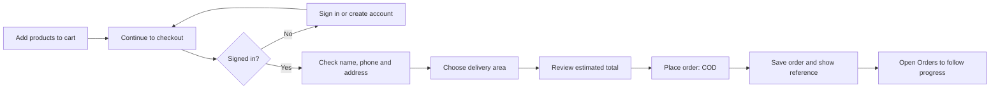

# Frostly — User Manual

This guide covers the customer storefront and administrator console. Screens and labels may appear in English or Bangla depending on the language selector. The examples assume the site has been connected to Supabase and its required migrations have been applied.

## Contents

1. [Open Frostly](#1-open-frostly)
2. [Browse and choose products](#2-browse-and-choose-products)
3. [Create an account and sign in](#3-create-an-account-and-sign-in)
4. [Manage your profile](#4-manage-your-profile)
5. [Place a Cash on Delivery order](#5-place-a-cash-on-delivery-order)
6. [View orders and rate delivered products](#6-view-orders-and-rate-delivered-products)
7. [Administrator access](#7-administrator-access)
8. [Use the admin dashboard](#8-use-the-admin-dashboard)
9. [Troubleshooting](#9-troubleshooting)

## 1. Open Frostly

For local use, open a terminal in the project folder and run:

```powershell
py -m http.server 8000
```

Keep that window open, then visit `http://localhost:8000`. To stop the local server, press `Ctrl+C`. The deployed store is opened at its Cloudflare Pages domain.

The storefront starts in English. Use the language dropdown to switch to Bangla; your choice is remembered in that browser.

## 2. Browse and choose products

1. Browse the home page, categories, best sellers, or all products.
2. Use search to find an item.
3. Select a product card to open its product details and larger image.
4. Use **Add to Cart** to add an item. Open the cart control to review items, quantities, subtotal, and checkout.
5. Use the heart control to manage your wishlist.

Product names, prices, stock, and images depend on the catalog configured by the store. Demo catalog data must be replaced by the operator before real sales.

## 3. Create an account and sign in

1. Open the account/profile control and choose **Create an account**.
2. Enter your name, email and password, then submit.
3. If email confirmation is enabled, open the confirmation email before signing in.
4. For returning customers, choose **Sign in** and enter your email and password.
5. If you cannot remember your password, choose the password-recovery link and follow the email instructions.

The exact confirmation steps depend on the Supabase Auth settings configured by the site operator.

## 4. Manage your profile

Open your account/profile panel after signing in. You can update your displayed name, phone number and profile picture, and change your password by entering your current password and a new password with confirmation. Use the saved-address/default-address controls available in the account/checkout experience to make delivery faster. Sign out from the account panel when finished on a shared device.

The change-password section no longer shows an extra plus/minus toggle mark beside its heading.

If an update reports an error, check that the account is signed in and that profile/storage migrations are installed. A profile photo must be a supported image type and within the configured upload limit.

## 5. Place a Cash on Delivery order



1. Open the cart and choose **Checkout**.
2. Sign in if prompted.
3. Confirm the recipient name, phone number, delivery address, delivery area and optional instructions.
4. Choose whether to save the address if that option is shown.
5. Review items, subtotal and delivery fee. The fee comes from the selected active delivery area.
6. Choose **Place order**. Cash on Delivery is the enabled payment method.
7. Keep the order reference shown after successful submission; use the **Orders** action to go to your orders.

The displayed total is an estimate until the database validates the current price, stock and delivery fee when the order is submitted. If checkout reports that no delivery areas are configured, the store administrator must activate delivery areas in the dashboard/Supabase first. Do not submit payment details; online card/mobile-wallet payment is not implemented.

## 6. View orders and rate delivered products

Use the separate Orders control to open the customer order drawer. Filter orders by their status, refresh the list, and select an order reference/card to expand its products and order details. Active/in-progress, delivered and cancelled orders may be shown in separate filters.

After an order is marked **Delivered**, an eligible customer can rate a product included in that order. Choose one to five stars and optionally write a short review. A customer can update their rating for that product. Reviews are public storefront content, so avoid including private information.

## 7. Administrator access

The administrator console is available at the console HTML filename distributed with the project. Its filename is not a security boundary. Access requires signing in with an account that has an enabled staff role; direct URL access by a normal customer should be denied by the application and database policies.

The first administrator account must be created as a normal customer account and then promoted by a trusted operator in the Supabase SQL Editor. Follow the SQL in the repository `README.md`. Never share the SQL Editor with untrusted users and never expose a service-role key in the website.

### Staff roles

| Role | Access |
| --- | --- |
| Superadmin | All admin operations plus the User management page and staff role assignment |
| Administrator | Full day-to-day store operations; cannot assign staff roles |
| Order manager | Overview, orders, order status updates and customer summaries |
| Stock manager | Overview and inventory adjustments |
| Catalog manager | Product and category catalog editing |
| Delivery manager | Delivery areas and fees |
| Settings manager | Store name, logo, homepage slides, contact and payment display settings |
| Delivery staff | Existing delivery role; assignment-specific operations depend on configured delivery workflows |

Superadmins can change the roles of existing accounts. A role change takes effect for subsequent database requests. The dashboard preserves at least one superadmin and prevents the signed-in superadmin from removing their own access. To grant a new staff member access, have them create and confirm their account first, then select their account and role in **User management**.

### Change the administrator sign-in email

Open the profile menu in the dashboard header and choose **Profile and email**. Enter the new address and your current password, then send the verification email. The email used to sign in remains unchanged until you open the Supabase verification link. Supabase Auth Site URL and redirect allow-list settings must include the live Frostly domain for verification to return correctly.

## 8. Use the admin dashboard

### Overview

The overview displays live order/sales and stock summaries. Select the low-stock product card to open the inventory view and update affected product stock/reorder information.

### Orders

1. Open **Orders** and use search/status filters to locate an order.
2. Processing and delivered order shortcuts filter the list.
3. Review the customer, delivery address, items, totals and placed time.
4. Select an allowed status and save. Available statuses include awaiting confirmation, confirmed, preparing, packed, out for delivery, delivered and cancelled. The database validates status transitions and records history.
5. Refresh the dashboard if another administrator has changed data.

### Products and inventory

1. Open **Products** and choose **New product** or edit an existing product.
2. Enter product names, category, price, stock and other required catalog information.
3. Upload a JPG, PNG, or WebP image up to 5 MB, or enter an image URL if the form allows it.
4. Save the product. Use the inventory view for stock adjustments; adjustments are recorded in inventory movement history.
5. Check that the product is active and the image is publicly accessible before expecting it to show in the storefront.

### Delivery areas

Open the delivery area/zone section to add or edit an area name, delivery fee, and active state. A zone must be active for customers to select it at checkout. Confirm the actual fee before enabling the area. The initial migration seeds Inside Chattogram Town at ৳80 and Outside Chattogram Town at ৳120.

### Store settings

Open **Settings** to edit the site name, logo, homepage hero slides, service area, phone, email and payment-method display text. Upload supported images where offered, edit slide text in both languages if shown, then use the relevant save button and wait for its saved confirmation. Refresh the storefront to confirm the public settings update.

Contact information appears in the storefront footer only when values are configured. Use real customer-facing contact details; placeholder data should be replaced. The payment-method footer text is informational and does not add a payment gateway.

### Admin profile and sign-out

Open the admin name/avatar control in the dashboard header to view the signed-in administrator identity and choose **Sign out**. Admin role changes and password recovery are managed through the account/Supabase Auth process.

## 9. Troubleshooting

| Problem | What to do |
| --- | --- |
| The local website will not open | Check that the Python server is still running in the Frostly project folder and use `http://localhost:8000`. |
| Sign-in or account creation fails | Check the email/password, confirmation email, internet connection and Supabase Auth configuration. |
| Checkout cannot continue | Sign in, fill all required fields, and confirm that the chosen area is active and has a delivery fee. |
| Stock or total changes at checkout | The final calculation uses current database prices and stock. Review the cart and try again if an item sold out. |
| Admin dashboard says access denied | Use the account specifically promoted to admin; a hidden/obscure page URL does not make an account an administrator. |
| Image upload fails | Use JPG, PNG or WebP under 5 MB and confirm the relevant storage migration is installed. |
| Changes do not appear on the live site | Confirm the settings save completed, the correct Supabase project is connected, and the latest Git commit deployed in Cloudflare Pages. Refresh without cache. |
| Review controls are missing | The order must be delivered, the product must be in that order, and migration `202610220009_product_ratings.sql` must be applied. |

For technical setup, migration details, security notes and deployment configuration, see [Project Documentation](PROJECT_DOCUMENTATION.md) and the repository [README](../README.md).
